# 🗡️ El Último Cazador

> *Plata para los muertos. Acero para los hombres.*

Juego de acción y aventura 3D con **desplazamiento lateral (2.5D)** y **batallas por turnos**, ambientado en un mundo de fantasía oscura y desarrollado en equipo con el motor gráfico **Godot 4**. Versión actual: **0.2.0-beta**.

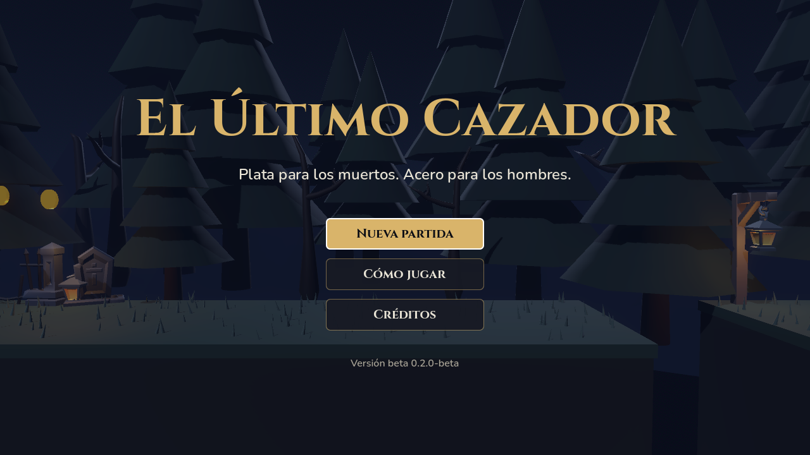

| | |
|---|---|
| 📦 **Repositorio** | https://github.com/ElJavierB0/el-ultimo-cazador-ue5 |
| 📋 **Proyecto (tarjetas)** | https://github.com/users/ElJavierB0/projects/3 |
| 🎮 **Caso práctico (prototipo jugable)** | https://ultimo.loopsoftware.com.mx · [código](https://github.com/ElJavierB0/el-ultimo-cazador) |
| 📘 **Act 2 · Portafolio de evidencias** (beta, manual y reporte de pruebas) | [docs/Act2-Portafolio-de-Evidencias.docx](docs/Act2-Portafolio-de-Evidencias.docx) |
| 📄 **Act 1 · GDD** | [docs/GDD-El-Ultimo-Cazador-UE5.docx](docs/GDD-El-Ultimo-Cazador-UE5.docx) |
| 🖥️ **Act 1 · Documento técnico** | [docs/Documento-Tecnico-Hardware-Software.docx](docs/Documento-Tecnico-Hardware-Software.docx) |

> **Creación de Videojuegos.** Act 1, parte 2: planeación en equipo. **Act 2: beta del videojuego con POO.** Act 3: liberación y distribución.

---

## 🎮 Actividad 2: versión beta

La beta incluye el **nivel 1 completo** (Bosque de Velmora): exploración, dos enemigos, el guardián, trueque, puntaje, vidas y las pantallas de inicio a fin.

| Elemento solicitado | Cómo se integra | Código |
|---|---|---|
| **Eventos** | Bus de señales: quien provoca algo solo avisa; puntaje, interfaz y audio reaccionan | [`events.gd`](juego/scripts/autoload/events.gd) |
| **Comportamientos** | Patrulla, giro en orillas y paredes; el guardián vigila al jugador | [`enemy.gd`](juego/scripts/entities/enemy.gd), [`guardian.gd`](juego/scripts/entities/guardian.gd) |
| **Transacciones** | Trueque de monedas con validación, comprobante e historial | [`shop.gd`](juego/scripts/core/shop.gd), [`transaction.gd`](juego/scripts/core/transaction.gd) |
| **Acciones** | Correr, saltar y seis acciones de batalla | [`player.gd`](juego/scripts/entities/player.gd), [`battle/actions/`](juego/scripts/battle/actions) |
| **Colisiones** | Suelo, paredes, objetos, enemigos, vacíos y agua | [`entity.gd`](juego/scripts/entities/entity.gd), [`trigger.gd`](juego/scripts/items/trigger.gd) |
| **Puntaje** | Cálculo por eventos con desglose por nivel | [`score_system.gd`](juego/scripts/core/score_system.gd) |
| **Oportunidades (vidas)** | 3 vidas, puntos de control, reaparición y fin de la partida | [`game.gd`](juego/scripts/autoload/game.gd), [`bonfire.gd`](juego/scripts/items/bonfire.gd) |

### Capturas
| | |
|---|---|
| 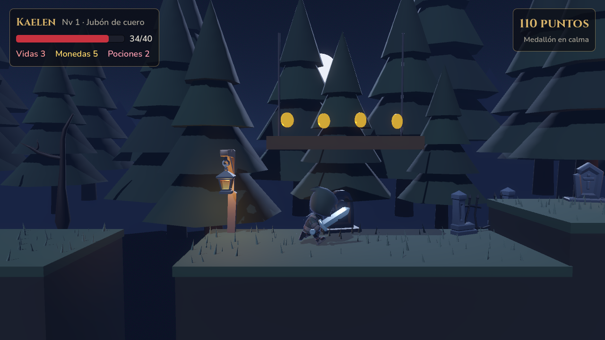 Exploración | 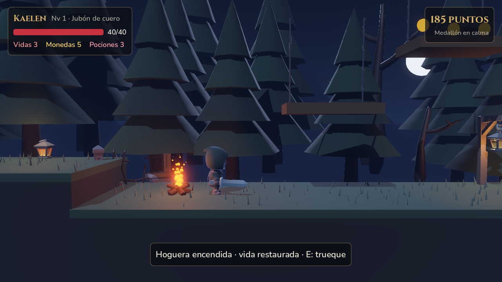 Hoguera (punto de control) |
| 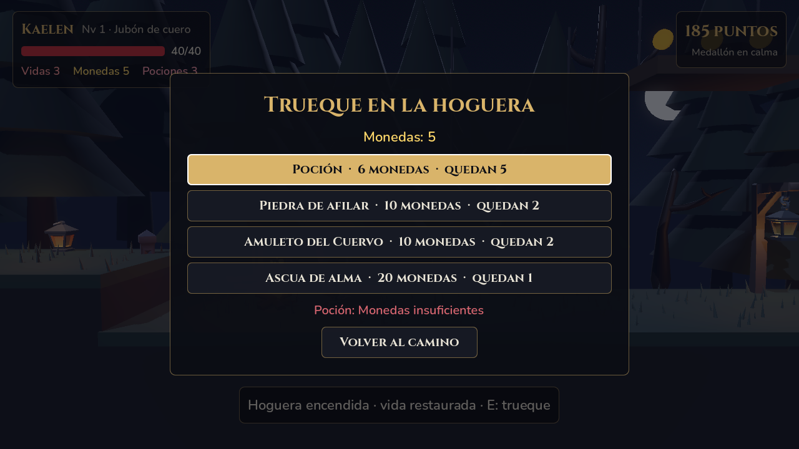 Transacción rechazada por falta de monedas | 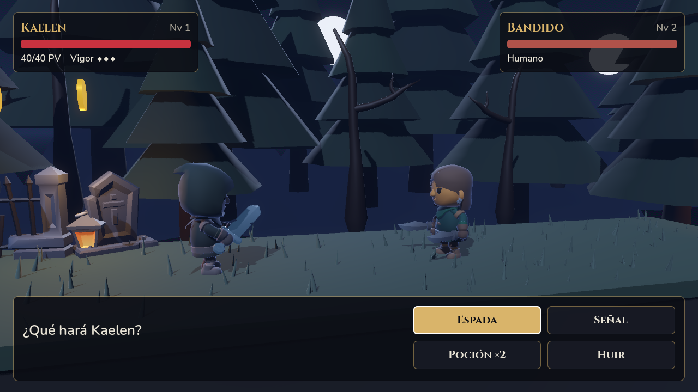 Menú de batalla |
| 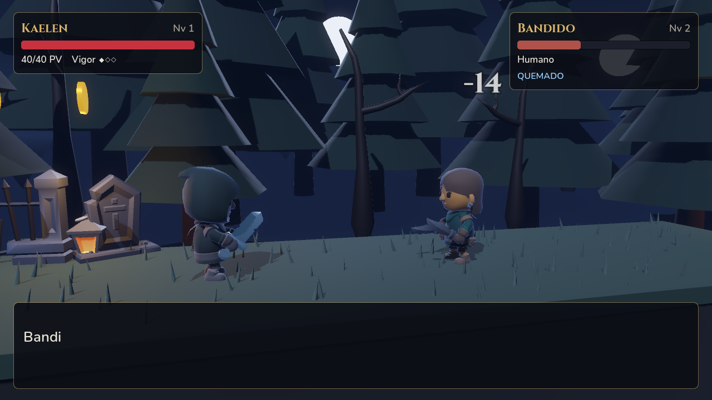 Señal Ascua | 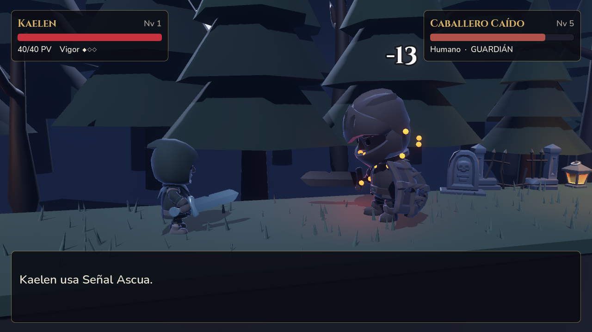 Guardián del nivel |
| 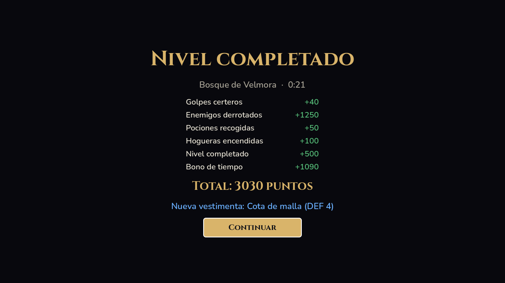 Desglose del puntaje | 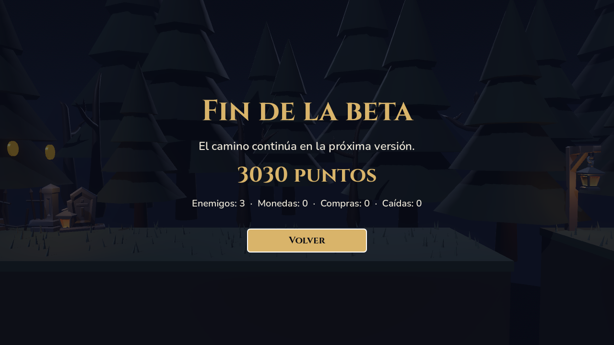 Fin de la beta |

### Ejecutar
1. Instalar [Godot 4.7](https://godotengine.org/download) (versión estándar).
2. Clonar este repositorio e importar `juego/project.godot`.
3. Presionar **F5**.

```bash
godot --headless --path juego --import                      # primera vez
godot --path juego                                          # jugar
godot --headless --path juego res://tests/tests.tscn        # 72 pruebas automáticas
```

### Controles
| Acción | Tecla |
|---|---|
| Moverse / saltar | ← → o A D / Espacio, ↑ o W |
| Trueque en la hoguera | E |
| Menús y batalla | Flechas + Enter, o el mouse |
| Volver / pausa · sonido | Esc o P · M |

### Programación orientada a objetos

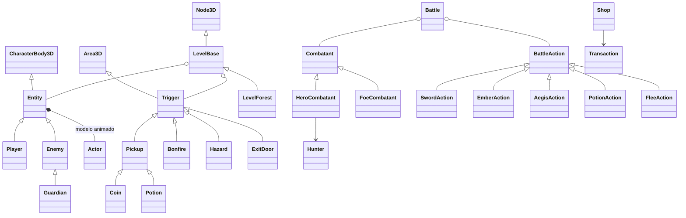

| Concepto | Dónde se aplica |
|---|---|
| **Abstracción** | `Entity`, `Trigger`, `Combatant`, `BattleAction` y `LevelBase` definen lo común y dejan los detalles a sus hijas |
| **Encapsulamiento** | La vida y las monedas de `Hunter` se manejan con métodos (`take_damage`, `spend_coins`) que validan; `Shop` no deja compras a medias |
| **Herencia** | `Entity → Enemy → Guardian`, `Trigger → Pickup → Coin`, `LevelBase → LevelForest` |
| **Polimorfismo** | `_behave()`, `_touch()`, `_collect()`, `execute()` e `is_boss()` responden según la clase |
| **Composición** | Cada `Entity` tiene un `Actor`; cada `Battle` reúne combatientes y acciones |
| **Patrones** | Observador (`Events`), Comando (`BattleAction`), Método plantilla (`LevelBase`, `Entity`), Fábrica (`Enemy.create`) |

### Cambio de motor: de Unreal Engine 5 a Godot 4
La planeación de la Act 1 proponía Unreal Engine 5. Al iniciar el desarrollo se cambió a **Godot 4.7** por estas razones:

- **Equipo disponible:** Unreal con C++ en macOS necesita Xcode y decenas de GB; Godot se descarga en menos de 200 MB y no pide herramientas adicionales.
- **Trabajo en equipo:** las escenas y el código de Godot son texto, así que los Pull Requests se pueden revisar línea por línea. Los mapas y Blueprints de Unreal son binarios.
- **Alcance:** permite una beta jugable en el tiempo de la actividad y exportar a web, Windows y macOS.

El diseño del juego (historia, personajes, mecánicas, niveles y puntaje) no cambia. El GDD y el documento técnico se conservan como se entregaron en la Act 1.

| Planeado en UE5 | Equivalente en Godot |
|---|---|
| Character Movement Component | `CharacterBody3D` (`Entity`) |
| Data Assets | `Bestiary` |
| BattleManager + Sequencer | `Battle` + cámara del nivel |
| ScoreSubsystem | `ScoreSystem` (autoload `Game`) |
| UMG | Nodos `Control` (`UiKit`, `Hud`, `BattleUi`) |
| Niagara | `CPUParticles3D` (`Fx`) |
| MetaSounds | Síntesis propia (`tools/generate_audio.gd`) |

---

## 👥 Equipo

| Integrante | Rol | GitHub |
|---|---|---|
| **Guadalupe Amavizca Quintero** | Arte, niveles, audio y documentación | [@Guadalupe-16](https://github.com/Guadalupe-16) |
| **Javier Antonio Romo Bernal** | Programación, animación y efectos | [@ElJavierB0](https://github.com/ElJavierB0) |

**Profesor:** Ivan Rogelio Chenoweth Chenoweth · **Materia:** Creación de Videojuegos · Universidad Tecnológica de Hermosillo

---

## 📌 Propuesta (resumen del GDD)

### Ficha
| Elemento | Descripción |
|---|---|
| **Motor** | Godot 4.7 (planeado originalmente en Unreal Engine 5) |
| **Plataforma** | PC (Windows y macOS), distribución en itch.io |
| **Género** | Plataformas de acción 2.5D + RPG por turnos |
| **Público objetivo** | 13 años en adelante (ESRB T), jugadores de PC que disfrutan los indie de fantasía oscura |
| **Duración** | 45 a 60 minutos · 1 jugador |
| **Estilo** | 3D estilizado oscuro: luz de luna con sombras, niebla, resplandor y partículas |

### Historia
Hace un siglo, la **Orden del Cuervo** protegía el reino de Velmora de las bestias que nacen de la niebla. Traicionada por el reino, la Orden cayó y solo queda uno: **Kaelen, el último cazador**. Una ceniza negra cae desde el castillo del norte: donde toca, los muertos se levantan y los hombres se corrompen. Kaelen recorre el Bosque de Velmora, el Pantano de Bruma y el Castillo de Ceniza para enfrentar al **Señor de la Ceniza**.

### Personajes
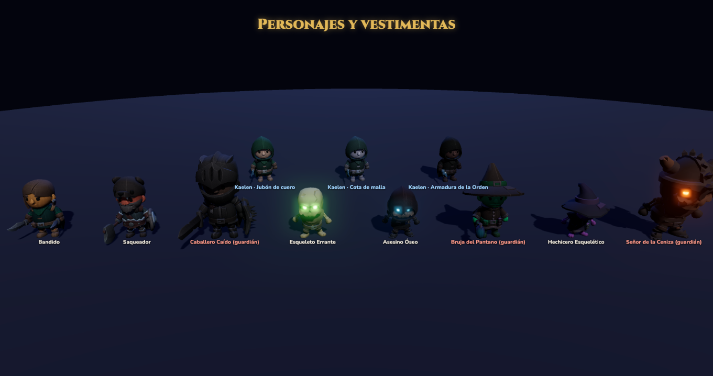

- **Kaelen** (protagonista): encapuchado, capa raída y espada de plata. PV 40, ATK 6, DEF según vestimenta.
- **Enemigos (ninguno se repite):** Bandido, Saqueador (humanos) · Esqueleto Errante, Asesino Óseo, Hechicero Esquelético (no-muertos).
- **Guardianes:** Caballero Caído (bosque), Bruja del Pantano (pantano), Señor de la Ceniza (castillo).

### Mecánicas
1. **Exploración lateral:** correr, salto variable con *coyote time* y *jump buffer*, monedas, pociones y hogueras (guardan la partida y curan).
2. **Batalla por turnos** con cámara cinematográfica: **ESPADA** (Acero o Plata), **SEÑAL** (Ascua o Égida, gastan vigor), **POCIÓN** o **HUIR**.
3. **Progresión:** experiencia → nivel (+PV, +ATK) y una vestimenta nueva por nivel completado.

### Niveles
| # | Nivel | Enemigos | Guardián |
|---|---|---|---|
| 1 | Bosque de Velmora | Bandido, Saqueador | Caballero Caído |
| 2 | Pantano de Bruma | Esqueleto Errante, Asesino Óseo | Bruja del Pantano |
| 3 | Castillo de Ceniza | Hechicero Esquelético | Señor de la Ceniza |

**Boceto del mapa del nivel 1** (comportamiento general en el GDD, sección 7):

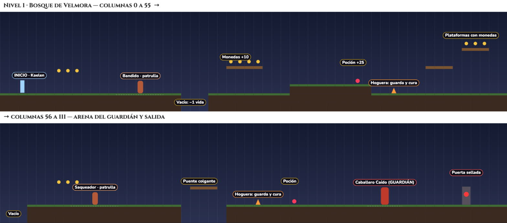

### Armas y vestimenta
| Arma / señal | Efecto |
|---|---|
| Espada de acero | ×1.5 contra humanos, ×0.5 contra no-muertos |
| Espada de plata | ×1.5 contra no-muertos, ×0.5 contra humanos |
| Señal Ascua | Fuego: ignora la defensa y quema 2 turnos (2 de vigor) |
| Señal Égida | Escudo: reduce a la mitad el siguiente golpe (1 de vigor) |

Vestimentas: **Jubón de cuero** (+2 DEF) → **Cota de malla** (+4) → **Armadura de la Orden** (+6).

### Objetos especiales
Monedas, pociones, hogueras, puerta sellada del guardián y medallón (detecta enemigos). Fondos con profundidad real: bosque nocturno con luna, pantano con niebla verde y castillo con cielo rojo y brasas.

### Storyboard
| | |
|---|---|
| 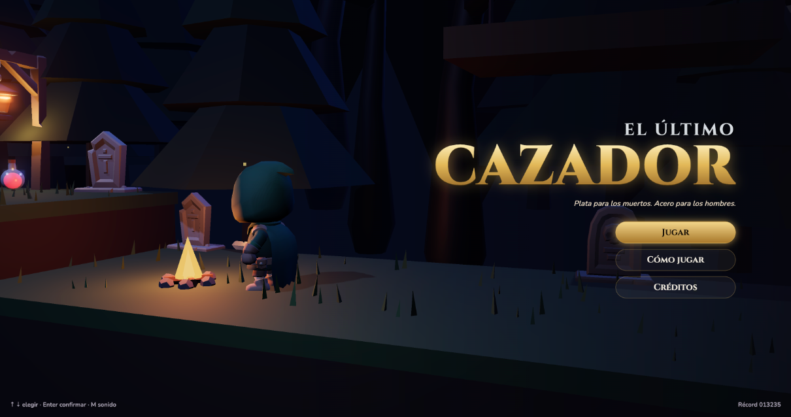 Título | 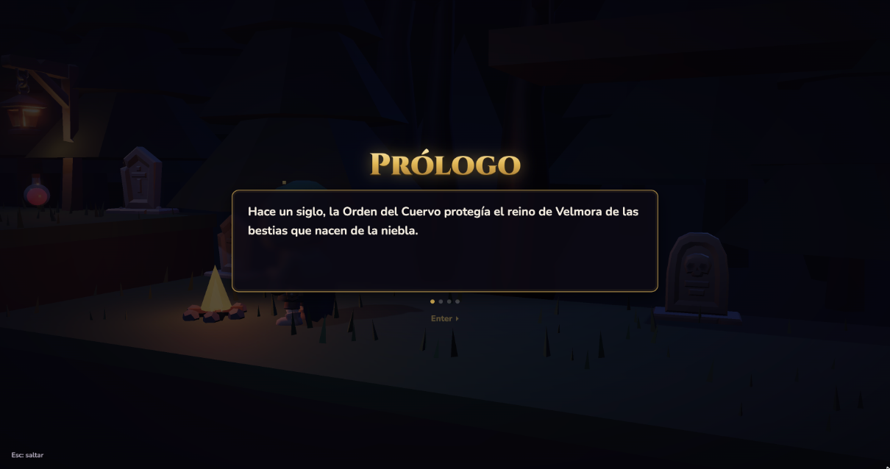 Prólogo |
| 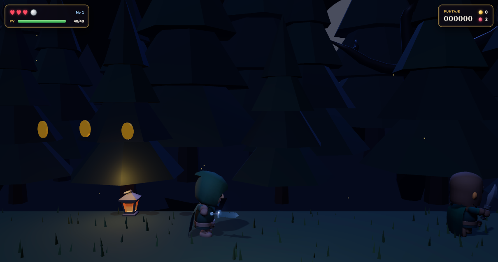 Exploración | 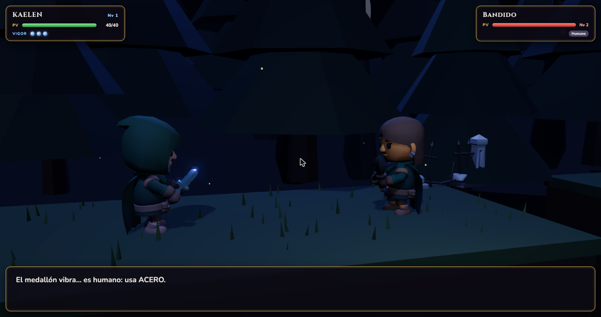 Inicio de batalla |
| 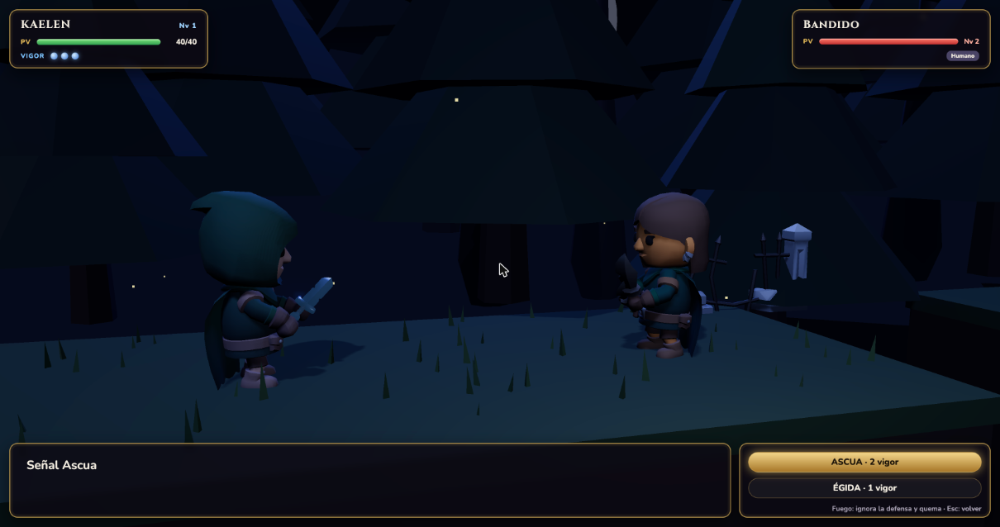 Menú de batalla | 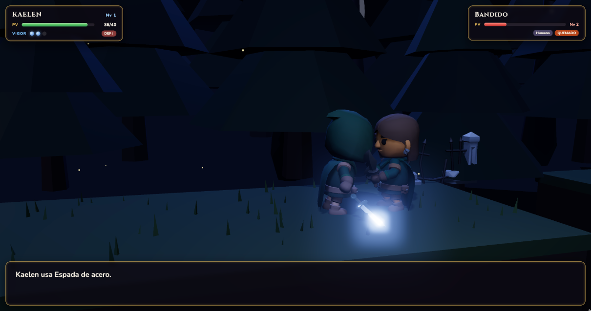 Ataque |
| 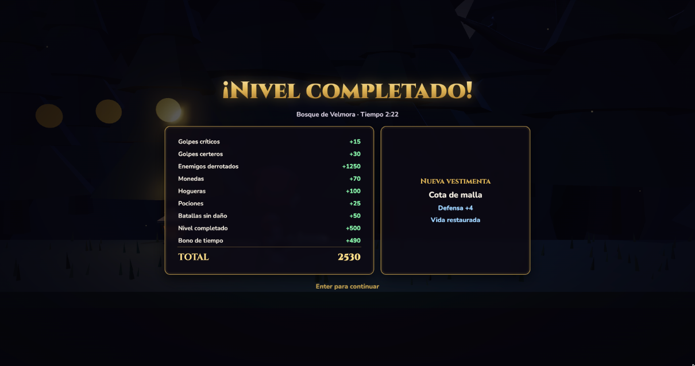 Nivel completado | |

El guion completo (prólogo, diálogos de batalla, escenas entre niveles y epílogo) está en el GDD, sección 12.

### Música y efectos de audio
- **Música original por nivel** (en la beta: título, bosque, batalla y jefe), sintetizada por código a partir de partituras propias.
- **Efectos:** salto, moneda, poción, hoguera, cortes de acero y plata, fuego, escudo, golpes, victoria, derrota, menú y medallón.

### Score (cálculo sobre los eventos)
| Evento | Puntos |
|---|---|
| Moneda / poción / hoguera | +10 / +25 / +50 |
| Golpe certero / crítico | +10 / +15 |
| Enemigo derrotado | +100 a +220 (guardianes +1000 / +1500 / +2500) |
| Batalla sin daño / nivel completado | +50 / +500 |
| Bono de tiempo | (240 − segundos) × 5 |
| Vidas al terminar | +1000 por vida |
| Huir / perder una vida | −25 / −200 |

```
puntaje = Σ(puntos de eventos) + Σ(bonos de tiempo) + vidas × 1000
```

---

## 🗺️ Plan de trabajo

### Fases
| Fase | Entregables | Responsable |
|---|---|---|
| 1. Planeación (Act 1) | GDD, documento técnico, README y tablero | Ambos |
| 2. Preproducción | Concept art con IA, proyecto base en Godot, mapa del nivel 1 | Guadalupe: arte · Javier: proyecto |
| 3. Producción | Personajes, animaciones, niveles, batalla, interfaz, música y efectos | Ambos |
| 4. Pruebas y liberación | Pruebas beta, balance, empaquetado para PC y publicación en itch.io | Ambos |

### Quién va a trabajar en qué
| Área | Javier | Guadalupe |
|---|---|---|
| Programación | Proyecto base, movimiento 2.5D, batalla por turnos, enemigos y cámara | Puntaje, guardado e inventario |
| Arte | Animaciones, paletas y efectos de partículas | Concept art con IA, materiales, escenografía y props |
| Niveles | Sistema de niveles y nivel 1 | Nivel 2 y decoración |
| Interfaz | Programación del HUD y menú de batalla | Diseño visual de la interfaz |
| Audio | Generador de audio y efectos | Música de los niveles siguientes |
| Documentación | README técnico, manual y pruebas automáticas | GDD y pruebas con personas |

### Plan técnico Git
- **Archivos de texto:** escenas, scripts y configuración de Godot se versionan como texto; los modelos, audio y tipografías son binarios ligeros (ver [`.gitattributes`](.gitattributes)).
- **`.gitignore`:** se excluyen la caché `.godot/` y las exportaciones `builds/` (ver [`.gitignore`](.gitignore)).
- **Ramas:** `main` (estable) + `feature/<tarea>` por tarjeta (ej. `feature/beta-godot`, `feature/nivel-2-pantano`).
- **Commits** en español con prefijo (`feat:`, `fix:`, `art:`, `docs:`) y **Pull Request** revisado por el otro integrante.
- **Tablero:** Pendiente → En progreso → En revisión → Hecho, con campos **Responsable** y **Fase**, e issues de programación y de **elaboración artística**.

### Arte
La beta usa modelos KayKit (CC0) recoloreados con un shader propio. El arte propio sigue planeado así: concept art (IA de imágenes) → modelo base (IA de imagen a 3D) → limpieza en Blender → rig y animación con Mixamo → importación al motor. Cada asset generado tiene su tarjeta en el tablero con la herramienta usada y su licencia.

---

## 🙏 Créditos
- **Programación, animación y efectos:** Javier Antonio Romo Bernal
- **Arte, niveles, audio y documentación:** Guadalupe Amavizca Quintero
- **Motor:** Godot Engine 4 (licencia MIT)
- **Modelos 3D y animaciones:** [KayKit](https://kaylousberg.com) por Kay Lousberg ([CC0](https://creativecommons.org/publicdomain/zero/1.0/))
- **Tipografías:** Cinzel y Nunito (SIL Open Font License, licencias en `juego/assets/fonts`)
- **Caso práctico:** prototipo web El Último Cazador (JavaScript, Three.js)
