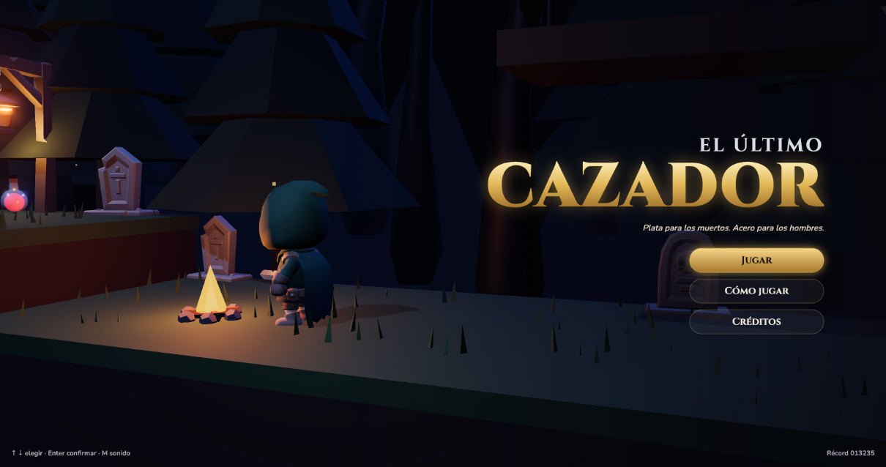
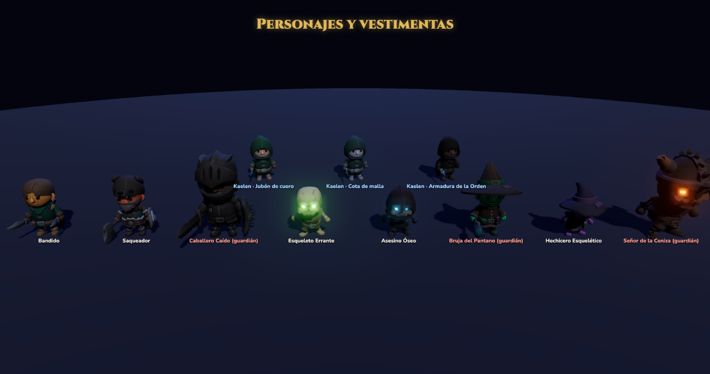
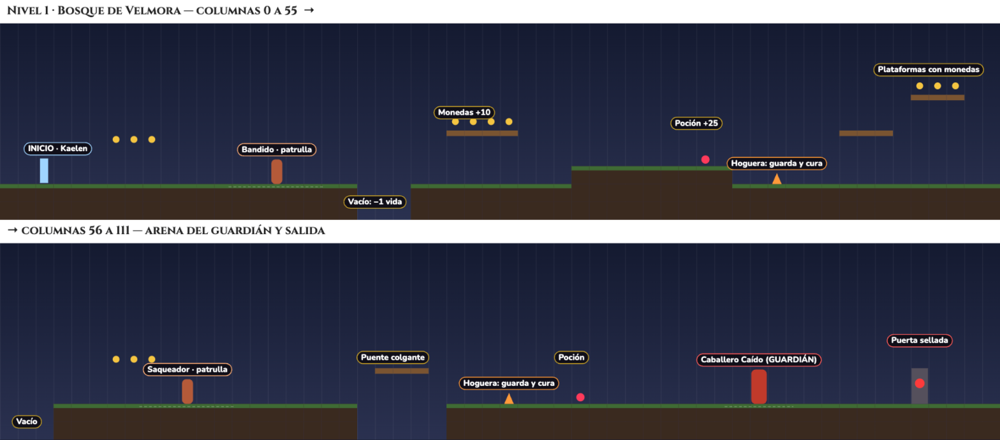
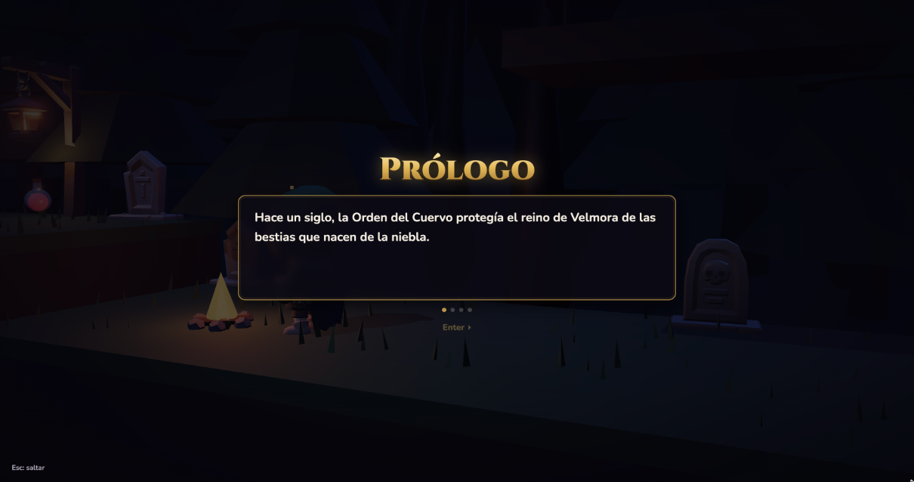
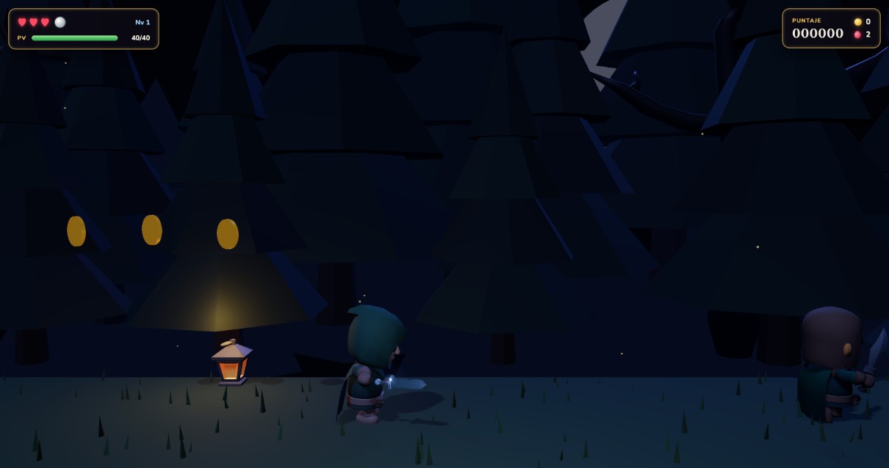
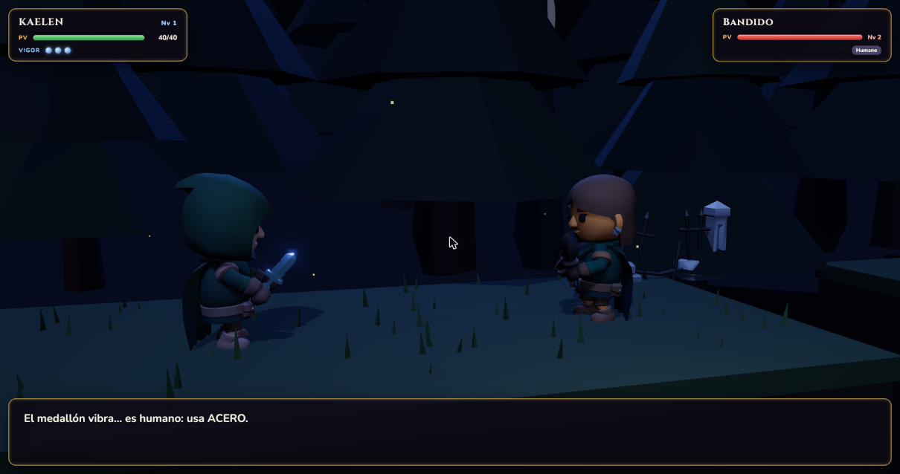
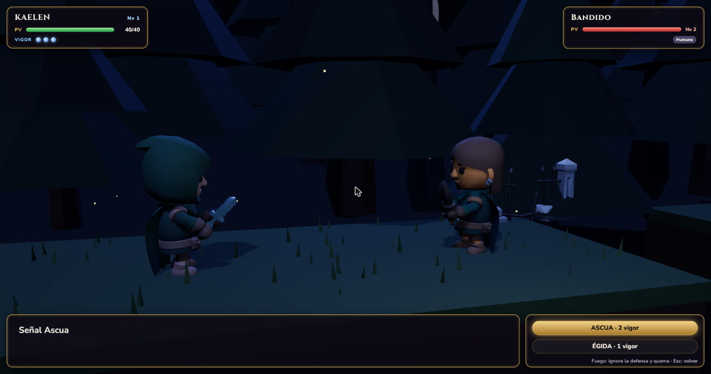
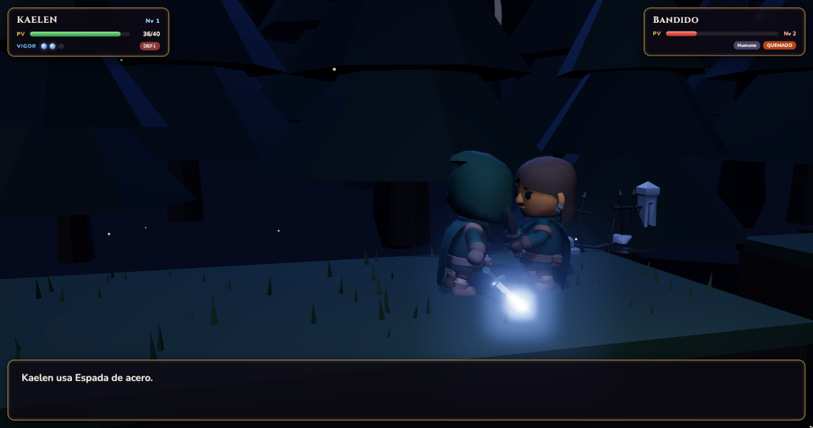
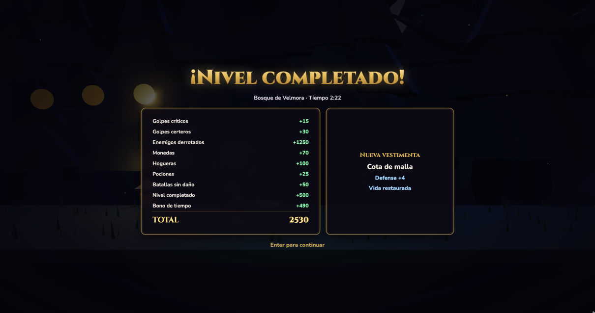

# 🗡️ El Último Cazador · Unreal Engine 5

> *Plata para los muertos. Acero para los hombres.*

Planeación en equipo de un videojuego con motor gráfico: **El Último Cazador**, un juego de acción y aventura 3D con **desplazamiento lateral (2.5D)** y **batallas por turnos**, ambientado en un mundo de fantasía oscura, a desarrollarse en **Unreal Engine 5**.


*Splash tomado del prototipo jugable; la versión UE5 lo recreará con arte propio.*

| | |
|---|---|
| 📦 **Repositorio** | https://github.com/ElJavierB0/el-ultimo-cazador-ue5 |
| 📋 **Proyecto (tarjetas)** | https://github.com/users/ElJavierB0/projects/3 |
| 🎮 **Caso práctico (prototipo jugable)** | https://ultca.loopsoftware.com.mx · [código](https://github.com/ElJavierB0/el-ultimo-cazador) |
| 📄 **GDD** | [docs/GDD-El-Ultimo-Cazador-UE5.docx](docs/GDD-El-Ultimo-Cazador-UE5.docx) |
| 🖥️ **Documento técnico** | [docs/Documento-Tecnico-Hardware-Software.docx](docs/Documento-Tecnico-Hardware-Software.docx) |

> **Creación de Videojuegos · Actividad 1, parte 2 (en equipo).** Portafolio de evidencias: este README, la propuesta (documento técnico y GDD) y el proyecto en GitHub con sus tarjetas.

---

## 👥 Equipo

| Integrante | Rol | GitHub |
|---|---|---|
| **Guadalupe Amavizca Quintero** | Arte, niveles, audio y documentación | [@Guadalupe-16](https://github.com/Guadalupe-16) |
| **Javier Antonio Romo Bernal** | Programación, animación y efectos | [@ElJavierB0](https://github.com/ElJavierB0) |

**Profesor:** Ivan Rogelio Chenoweth Chenoweth · **Materia:** Creación de Videojuegos · Universidad Tecnológica de Hermosillo

---

## 📌 Propuesta (resumen del GDD)

### Ficha
| Elemento | Descripción |
|---|---|
| **Motor** | Unreal Engine 5.5 (Blueprints + C++) |
| **Plataforma** | PC (Windows y macOS), distribución en itch.io |
| **Género** | Plataformas de acción 2.5D + RPG por turnos |
| **Público objetivo** | 13 años en adelante (ESRB T), jugadores de PC que disfrutan los indie de fantasía oscura |
| **Duración** | 45 a 60 minutos · 1 jugador |
| **Estilo** | 3D estilizado oscuro: iluminación Lumen, niebla volumétrica, partículas Niagara |

### Historia
Hace un siglo, la **Orden del Cuervo** protegía el reino de Velmora de las bestias que nacen de la niebla. Traicionada por el reino, la Orden cayó y solo queda uno: **Kaelen, el último cazador**. Una ceniza negra cae desde el castillo del norte: donde toca, los muertos se levantan y los hombres se corrompen. Kaelen recorre el Bosque de Velmora, el Pantano de Bruma y el Castillo de Ceniza para enfrentar al **Señor de la Ceniza**.

### Personajes


- **Kaelen** (protagonista): encapuchado, capa raída y espada de plata. PV 40, ATK 6, DEF según vestimenta.
- **Enemigos (ninguno se repite):** Bandido, Saqueador (humanos) · Esqueleto Errante, Asesino Óseo, Hechicero Esquelético (no-muertos).
- **Guardianes:** Caballero Caído (bosque), Bruja del Pantano (pantano), Señor de la Ceniza (castillo).

### Mecánicas
1. **Exploración lateral:** correr, salto variable con *coyote time* y *jump buffer*, monedas, pociones y hogueras (guardan la partida y curan).
2. **Batalla por turnos** con cámara cinematográfica: **ESPADA** (Acero o Plata), **SEÑAL** (Ascua o Égida, gastan vigor), **POCIÓN** o **HUIR**.
3. **Progresión:** experiencia → nivel (+PV, +ATK) y una vestimenta nueva por nivel completado.

### Niveles
| # | Nivel | Enemigos | Guardián |
|---|---|---|---|
| 1 | Bosque de Velmora | Bandido, Saqueador | Caballero Caído |
| 2 | Pantano de Bruma | Esqueleto Errante, Asesino Óseo | Bruja del Pantano |
| 3 | Castillo de Ceniza | Hechicero Esquelético | Señor de la Ceniza |

**Boceto del mapa del nivel 1** (comportamiento general en el GDD, sección 7):



### Armas y vestimenta
| Arma / señal | Efecto |
|---|---|
| Espada de acero | ×1.5 contra humanos, ×0.5 contra no-muertos |
| Espada de plata | ×1.5 contra no-muertos, ×0.5 contra humanos |
| Señal Ascua | Fuego: ignora la defensa y quema 2 turnos (2 de vigor) |
| Señal Égida | Escudo: reduce a la mitad el siguiente golpe (1 de vigor) |

Vestimentas: **Jubón de cuero** (+2 DEF) → **Cota de malla** (+4) → **Armadura de la Orden** (+6).

### Objetos especiales
Monedas, pociones, hogueras, puerta sellada del guardián y medallón (detecta enemigos). Fondos con profundidad real: bosque nocturno con luna, pantano con niebla verde y castillo con cielo rojo y brasas.

### Storyboard
| | |
|---|---|
|  Título |  Prólogo |
|  Exploración |  Inicio de batalla |
|  Menú de batalla |  Ataque |
|  Nivel completado | |

El guion completo (prólogo, diálogos de batalla, escenas entre niveles y epílogo) está en el GDD, sección 12.

### Música y efectos de audio
- **Música original por nivel** (título, bosque, pantano, castillo, batalla y jefe), compuesta con apoyo de IA generativa y reproducida con **MetaSounds**.
- **Efectos:** salto, moneda, poción, hoguera, cortes de acero y plata, fuego, escudo, golpes, victoria, derrota, menú y medallón.

### Score (cálculo sobre los eventos)
| Evento | Puntos |
|---|---|
| Moneda / poción / hoguera | +10 / +25 / +50 |
| Golpe certero / crítico | +10 / +15 |
| Enemigo derrotado | +100 a +220 (guardianes +1000 / +1500 / +2500) |
| Batalla sin daño / nivel completado | +50 / +500 |
| Bono de tiempo | (240 − segundos) × 5 |
| Vidas al terminar | +1000 por vida |
| Huir / perder una vida | −25 / −200 |

```
puntaje = Σ(puntos de eventos) + Σ(bonos de tiempo) + vidas × 1000
```

---

## 🗺️ Plan de trabajo

### Fases
| Fase | Entregables | Responsable |
|---|---|---|
| 1. Planeación (Act 1) | GDD, documento técnico, README y tablero | Ambos |
| 2. Preproducción | Concept art con IA, proyecto UE5 base con Git LFS, blockout del nivel 1 | Guadalupe: arte · Javier: proyecto |
| 3. Producción | Personajes, animaciones, niveles, batalla, interfaz, música y efectos | Ambos |
| 4. Pruebas y liberación | Pruebas beta, balance, empaquetado para PC y publicación en itch.io | Ambos |

### Quién va a trabajar en qué
| Área | Javier | Guadalupe |
|---|---|---|
| Programación | Proyecto base, movimiento 2.5D, batalla por turnos, enemigos y cámara | Puntaje, guardado e inventario |
| Arte | Rigging, animaciones y efectos Niagara | Concept art con IA, materiales, escenografía y props |
| Niveles | Hogueras, peligros y puerta del jefe | Blockout y decoración de los 3 niveles |
| Interfaz | Programación del HUD y menú de batalla (UMG) | Diseño visual de la interfaz |
| Audio | Integración con MetaSounds | Música y efectos con IA generativa |
| Documentación | README técnico | GDD, manual de usuario y reporte de pruebas |

### Plan técnico Git
- **Git LFS** para los binarios de Unreal (`.uasset`, `.umap`), texturas, audio y modelos (ver [`.gitattributes`](.gitattributes)).
- **`.gitignore` de Unreal:** se excluyen `Binaries/`, `Intermediate/`, `Saved/` y `DerivedDataCache/` (ver [`.gitignore`](.gitignore)).
- **Ramas:** `main` (estable) + `feature/<tarea>` por tarjeta (ej. `feature/batalla`, `feature/concept-art`).
- **Bloqueo de archivos** con `git lfs lock` en mapas y Blueprints compartidos.
- **Commits** en español con prefijo (`feat:`, `fix:`, `art:`, `docs:`) y **Pull Request** revisado por el otro integrante.
- **Tablero:** Pendiente → En progreso → En revisión → Hecho, con campos **Responsable** y **Fase**, e issues de programación y de **elaboración artística**.

### Arte con IA generativa
Concept art (IA de imágenes) → modelo base (IA de imagen a 3D) → limpieza en Blender → rig y animación con Mixamo → importación a UE5. Cada asset generado tiene su tarjeta en el tablero con la herramienta usada y su licencia.

---

## 🙏 Créditos
- **Programación, animación y efectos:** Javier Antonio Romo Bernal
- **Arte, niveles, audio y documentación:** Guadalupe Amavizca Quintero
- **Motor:** Unreal Engine 5 (Epic Games)
- **Caso práctico:** prototipo web El Último Cazador (JavaScript, Three.js, modelos KayKit CC0)
